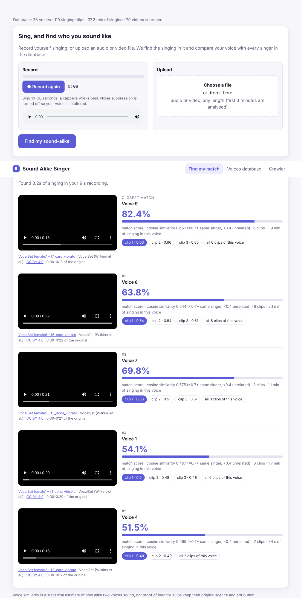

# Sound Alike Singer

Find out which singer you sound like.

1. **A crawler pre-searches videos** for singing, works out *where each different voice sings*, and saves
   those parts as separate **video clips** in a **singing-voices database**.
2. **You record yourself (or upload any audio/video).** The app finds the singing in your recording,
   builds a voice fingerprint, and returns the closest voices in the database, each with a playable clip.

Everything here runs for real, on CPU, with open pretrained models: no cloud API is needed to run it.

```
 discovery (Zenodo, Wikimedia Commons, folders, URLs)  ──►  queue (SQLite)  ──►  workers
                                                                                   │
   download ─► YAMNet + pitch-stability head ─► singing segments ─► CAM++ voice embeddings (3 s windows)
            ─► cluster windows per video (= distinct voices) ─► split segments at voice changes
            ─► cut each part as an MP4 clip ─► assign voice in the global database

 your recording ─► same detector ─► voice embedding ─► exact cosine search over every clip ─► best voices + clips
```

## Run it

```bash
python3 -m venv .venv && . .venv/bin/activate
pip install -r requirements.txt            # numpy, scipy, onnxruntime, fastapi, uvicorn, ... (tests: requirements-dev.txt)
sudo apt-get install ffmpeg                # (or brew install ffmpeg)
python -m soundalike download-models       # ~100 MB of ONNX models, SHA-256 verified
python -m soundalike serve                 # http://127.0.0.1:8000
```

Open the **Crawler** tab and press *Start crawling* (or `python -m soundalike crawl`); it resumes where it
stopped. Then use **Find my match**: press Record, sing for 10-30 s, press Stop, press *Find my sound-alike*.
You can also analyse your own media: `python -m soundalike ingest my_video.mp4`, or
`python -m soundalike crawl --folder ~/Videos`.

## Where the videos come from, and why not YouTube

The YouTube Data API key you supplied **works**, but the API only returns *metadata* (titles, ids, licences);
it never gives access to audio or video. Getting the media itself means downloading from `youtube.com` /
`googlevideo.com`, which YouTube's Terms of Service and API Developer Policies forbid (and which this sandbox's
network policy blocks). So the key is not used. The crawler uses sources whose licences *allow* analysing and
re-distributing clips, and stores each clip's author, licence and a link back to the original:

| source | what | status |
|---|---|---|
| **Zenodo** | open-access audio/video records (CC licences) | verified live against the real API |
| **Wikimedia Commons** | millions of CC / public-domain files; category-tree + search discovery | implemented to the documented MediaWiki API and tested against a local mock; **not** verified against the live site (blocked in the development sandbox) |
| **Folder / URL / upload** | anything you have the right to use | verified |

Adding a source is ~40 lines (`soundalike/sources/`): `seed_queries()`, `discover(query, cursor) -> Page`.

## "No limit"

There are no caps on videos searched, clips, or voices. Discovery pages through every query with persisted
cursors until the source is exhausted; sub-categories are discovered recursively; clips are files on disk;
metadata is SQLite; embeddings are a flat memory-mapped file (row = clip id, one `pwrite` per insert).
Search is an exact chunked cosine scan: 300k clips in well under a second on this machine, millions are fine,
and `Database.search_clips` is the one function to replace with an ANN index at much larger scale.
Real limits you will meet: the sources' own rate limits (Zenodo ≈ 60 requests/min unauthenticated) and CPU
time (≈ 10-15x faster than real time per worker).

## How well does it work? (measured on real recordings)

All numbers below were measured in this repository on real recordings (scripts in `scripts/`, tests in `tests/`).



**Finding the singing** (10 real songs, MUSDB18 *test* split, 5,296 one-second frames of which 3,320 contain vocals;
the detector never saw these songs; ground truth = loudness of each song's isolated vocal stem, `scripts/eval_segments.py`):

| | precision | recall | F1 |
|---|---|---|---|
| segments as the app produces them | 0.93 | 0.87 | **0.90** (per song 0.80 - 0.98) |
| raw per-frame score at 0.5 | 0.94 | 0.79 | 0.86 |

False-positive rates (frames scored as singing): 0.2 % of real speech, ~5 % of FMA "instrumental" clips (those are
not verified vocal-free), ~10 % of frames where singers *talk* the lyrics (VocalSet "spoken").
The off-the-shelf YAMNet "Singing" class turned out to be useless (it stays below 0.05 even on songs with
prominent vocals), which is why a small head is trained on top of YAMNet embeddings plus pitch-stability features.

**Matching voices** (VocalSet: 20 real singers; the query song is never in the gallery, chance = 5 %):
99 % top-1 on song recordings. Isolated-vowel scale exercises are much harder (18 - 20 %).
With accompaniment (10 real songs, 10 different singers): a dry-voice query picks the right singer 95 % of the time
from clips with the full band, identical to the oracle with perfectly isolated vocals (so no vocal-separation model is used);
accompaniment lowers same-singer similarity from ~0.71 to ~0.55 while different singers stay ~0.28.
Browser test: Chromium recorded a real singer through a fake microphone, uploaded it, and the top match was the right
singer, with a playable clip (`scripts/ui_e2e.cjs`; 2 of 2 singers tried).

**Voices** (79 real recordings of 20 singers ingested in order): 26 voices, 97 % pure by duration; 13 singers sit in exactly
one voice, 7 are split in two. The threshold is deliberately strict because a voice that mixes two singers is worse than
one singer split into two (clip-level matching is unaffected either way).

**Live crawl** (real Zenodo, from this sandbox): 20 minutes of crawling analysed 100+ real files out of ~4,600 discovered
(the rest stay queued; it resumes). It found real throat-singing videos, a concert recording and others, and rejected
tone/sonification files, speech and bat/insect recordings. The first run also *wrongly accepted* an iPad-instrument
ensemble study, animal calls and an insect video; those were added as hard negatives
(`scripts/hard_negatives.json`, `train_singing_head.py --extra-db`) and on 21 further unseen sources the ensemble family was
then rejected 4 of 4. Everything else the crawler accepted was judged by title, not by listening.

**Speed**: an 86 s video (detect + cluster + cut clips) takes ~5 s on 2 threads (about 15x real time).


## Honest limitations

* Voice similarity measures how alike two voices *sound* (timbre), not identity; similar voices happen.
* Detection quality drops for heavily distorted/screamed vocals, rap and very dense mixes. Sounds unlike anything the
  detector was trained on (animal calls, synthetic tones, unusual instruments) can still be accepted as singing: the
  first live crawl showed this. Fix by deleting the clips and adding the audio as hard negatives (see above).
* Concert-style vocals (loud crowd + band) are detected less reliably than studio vocals.
* The per-video voice clustering splits one singer into two voices more often than it merges two singers
  (deliberate: a wrong merge corrupts a voice, a split only duplicates it).
* Accuracy numbers above come from 20 (dry) + 10 (songs) singers; they are indicative, not a guarantee.
* Browser recording needs `https://` or `localhost` for microphone access.
* Environment knobs: `SOUNDALIKE_DATA` (database dir), `SOUNDALIKE_MODELS`, `SOUNDALIKE_CONTACT` (put a contact URL in the
  crawler's User-Agent: Wikimedia asks for this), `SOUNDALIKE_MAX_DOWNLOAD_GB` (per-file download cap, default 3),
  `SOUNDALIKE_ALLOW_PRIVATE_URLS=1` (allow LAN URLs in the "add URL" box; off by default as an SSRF guard).
* Keep the server on `127.0.0.1` unless you add authentication; it can start crawls and accept uploads.

## Development

```bash
scripts/setup_dev_data.sh                 # real test audio (VocalSet, LibriSpeech, FMA, MUSDB18 test songs)
python -m pytest -q                       # unit + real-audio integration tests
python scripts/eval_singing_detection.py  # singing detection on real songs with isolated vocal stems
python scripts/eval_singer_id.py          # singer identification on VocalSet
python scripts/calibrate.py               # same-/different-singer similarity thresholds
python scripts/train_singing_head.py [--musdb]   # retrain the singing detector head
```

Data/licence notes: models are Apache-2.0 (YAMNet, WeSpeaker CAM++). The singing head
(`soundalike/assets/singing_head.npz`, 40 KB) was trained on VocalSet (CC-BY 4.0), LibriSpeech (CC-BY 4.0),
FMA instrumental clips (assorted Creative Commons licences) and MUSDB18 *train* songs (non-commercial research
licence). Retrain without `--musdb` if you need a head with no non-commercial data.
